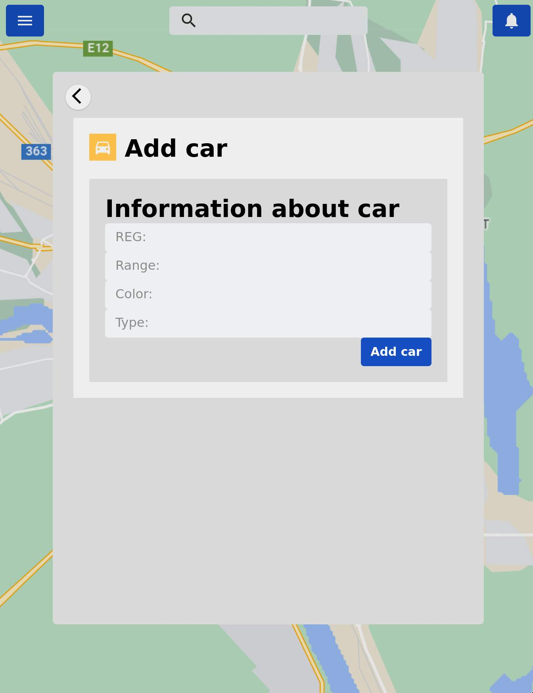

# car company vue web-app
As part of my interaction design course me and my group designed a interface for a fictional car company that offered self-driving cars, i developed this page hungover in my dorm, i coded in my bed because i was too hungover to move to my desk but i think it turned out alright to some arguable extent, took about a day with some later fixing and tinkering in the days after. We got a very good grade as i remember :)

